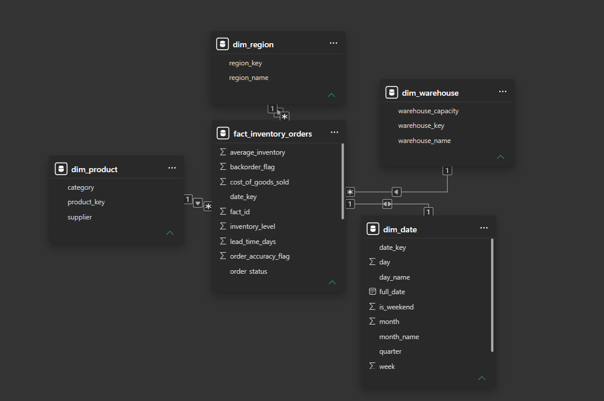

# 📦 Supply Chain & Inventory Management Analysis

> **End-to-end data analytics project** covering SQL-based data profiling, a star-schema data model, and a 4-page interactive Power BI dashboard — built on a real-world inventory/supply chain dataset spanning **2020–2024**.

---

## 📋 Table of Contents

- [Project Overview](#project-overview)
- [Dataset Description](#dataset-description)
- [Project Structure](#project-structure)
- [Data Model (Star Schema)](#data-model-star-schema)
- [SQL Analysis](#sql-analysis)
- [Power BI Dashboard](#power-bi-dashboard)
- [Key Metrics & Findings](#key-metrics--findings)
- [Tools & Technologies](#tools--technologies)
- [How to Use](#how-to-use)

---

## Project Overview

This project performs a comprehensive analysis of a multi-year inventory and supply chain dataset to uncover actionable insights across **sales demand, inventory efficiency, warehouse operations, logistics costs, and supplier performance**.

The analysis pipeline covers three layers:

1. **SQL** — data ingestion, quality checks, EDA, and business-logic queries across 33+ analytical queries
2. **Data Modeling** — a structured star schema separating dimensions from fact data for efficient slicing
3. **Power BI** — a 4-page interactive dashboard with custom visuals, synchronized slicers, and KPI gauges

---

## Dataset Description

**File:** `Inventory_SupplyChain_Dataset.csv`

| Attribute | Value |
|---|---|
| Total Records | 1,200 rows |
| Date Range | January 2020 – December 2024 (5 years) |
| Null Values | None (fully clean dataset) |
| Duplicate Records | None detected |

### Columns

| Column | Type | Description |
|---|---|---|
| `Date` | Date | Order date |
| `Region` | String | Geographic sales region (North, South, East, West) |
| `Category` | String | Product category (Electronics, Clothing, Furniture, Accessories) |
| `Supplier` | String | Supplier name (A, B, C, D) |
| `Warehouse` | String | Fulfillment warehouse (Warehouse 1, 2, 3) |
| `Order Status` | String | Fulfilled / Pending / Canceled |
| `Units Sold` | Integer | Number of units per order |
| `Inventory Level` | Integer | Stock on hand at order time |
| `Transportation Cost` | Float | Shipping/logistics cost per order |
| `Order Accuracy` | Boolean | Whether the order was fulfilled accurately |
| `Lead Time (Days)` | Integer | Days from order to fulfillment |
| `Backorder` | Boolean | Whether the item was in backorder |
| `Cost of Goods Sold (COGS)` | Float | Direct cost of goods for the order |
| `Average Inventory` | Float | Rolling average inventory level |
| `Warehouse Capacity` | Integer | Maximum warehouse storage capacity |

### Categorical Distributions

| Dimension | Values & Counts |
|---|---|
| Region | North (317), West (317), East (284), South (282) — near-uniform |
| Category | Electronics (314), Clothing (311), Furniture (306), Accessories (269) |
| Supplier | Supplier A (312), Supplier B (310), Supplier D (303), Supplier C (275) |
| Warehouse | Warehouse 1 (403), Warehouse 3 (403), Warehouse 2 (394) |
| Order Status | Fulfilled (838), Pending (248), Canceled (114) |
| Order Accuracy | Accurate (1,096 — 91.3%), Inaccurate (104 — 8.7%) |
| Backorder | Not in Backorder (1,084 — 90.3%), In Backorder (116 — 9.7%) |

---

## Project Structure

```
supplychain_analysis/
│
├── Inventory_SupplyChain_Dataset.csv   # Raw dataset (1,200 records, 15 columns)
├── supply_chain_analysis.sql           # 33+ SQL queries: DDL, EDA, business analysis
├── supply_chain_analysis.pbix          # Power BI dashboard (4 pages, star schema)
├── supply_chain_model.png              # Data model diagram (star schema screenshot)
└── README.md                           # Project documentation
```

---

## Data Model (Star Schema)

The Power BI report is built on a structured **star schema** with 1 fact table and 4 dimension tables.



### Tables

| Table | Type | Key Fields |
|---|---|---|
| `fact_inventory_orders` | Fact | units_sold, cost_of_goods_sold, transportation_cost, inventory_level, lead_time_days, order_accuracy_flag, backorder_flag, warehouse_capacity, average_inventory |
| `dim_date` | Dimension | full_date, year, month, month_name, quarter |
| `dim_region` | Dimension | region_name |
| `dim_product` | Dimension | category, supplier |
| `dim_warehouse` | Dimension | warehouse_name, average_warehouse_Capacity |
| `Measure Table` | DAX Measures | backorder_rate, capacity_utilization, inventory_turnover_ratio, total_orders, Accuracy Target, Backorder Status |

### Computed Measures (DAX)

| Measure | Description |
|---|---|
| `total_orders` | COUNT of all orders |
| `backorder_rate` | % of orders in backorder |
| `capacity_utilization` | Inventory Level / Warehouse Capacity |
| `inventory_turnover_ratio` | COGS / Average Inventory |
| `Accuracy Target` | Order accuracy KPI benchmark |
| `Backorder Status` | Backorder KPI status label |

---

## SQL Analysis

**File:** `supply_chain_analysis.sql`  
**Database:** MySQL (`inventory_management`)  
**Table:** `inventory_supplychain` (15 columns, matching CSV schema)

The SQL file covers **33+ queries** organized across the following analytical themes:

### 1. Database Setup & Ingestion
- `CREATE DATABASE` and `CREATE TABLE` with full column definitions and data types
- `LOAD DATA LOCAL INFILE` for bulk CSV ingestion with field/line terminator config

### 2. Data Quality & Profiling
- **Null check** across all 13 columns using conditional `SUM(CASE WHEN ... IS NULL)`
- **Duplicate detection** using `GROUP BY` + `HAVING COUNT(*) > 1` across key dimension columns
- **Date range** validation: `MIN()`, `MAX()`, `DATEDIFF()` to confirm 5-year span
- **Cardinality check**: distinct count across Region, Category, Supplier, Warehouse, Order Status

### 3. Univariate Descriptive Statistics
- `MIN`, `MAX`, `AVG` on: Units Sold, Inventory Level, Transportation Cost, Lead Time, COGS
- **Bucketing/binning** of Units Sold into quartile ranges (Q1–Q4) with `% to total`
- **Lead time distribution** across four buckets (1–7, 8–14, 15–21, 22+ days)
- Frequency distribution for: Region, Category, Supplier, Order Status, Order Accuracy, Backorder

### 4. Sales & Revenue Analysis
- COGS and Units Sold aggregated by: Region, Category, Supplier, Warehouse
- **Monthly trend**: `DATE_FORMAT(order_date, '%Y-%m')` with `SUM(units_sold)` and `SUM(COGS)`
- **Quarterly trend**: `NTILE(4) OVER(ORDER BY MONTH())` window function for Q1–Q4 bucketing
- **Monthly avg**: `AVG(units_sold)` and `AVG(COGS)` by year-month for seasonality analysis
- **Cross-tabulation**: Region × Category COGS breakdown

### 5. Inventory Analysis
- Avg, Max, Min inventory level by Region
- **Inventory turnover ratio** by Category: `SUM(COGS) / SUM(Average Inventory)`
- **Warehouse utilization rate**: `AVG(inventory_level) / AVG(warehouse_capacity)` per warehouse
- Low-stock alert: records where `inventory_level < 200`
- Stockout detection: orders where `units_sold > inventory_level`
- **Stock surplus analysis** by Category: `AVG(inventory_level) - AVG(units_sold)`
- Inventory turnover by Region × Supplier combination

### 6. Order Fulfillment & Backorder Analysis
- **Overall fulfillment rate**: `SUM(CASE WHEN status='Fulfilled') / COUNT(*)`
- Cancellation rate by Region
- Order status distribution within each Category using `PARTITION BY category` window function
- **Backorder profiling** by: Category, Supplier, Lead Time bucket, Inventory segment (above/below avg)
- Backorder correlation with: avg inventory level, avg units sold, avg lead time

### 7. Supplier Performance
- Supplier scorecard: accuracy rate %, backorder rate %, avg lead time, total COGS
- Lead time stats (min, max, avg) by Supplier and Category
- Cancellation rate by Supplier
- Supplier COGS ranking with `RANK() OVER` and `% contribution` to total
- Supplier × Warehouse cross analysis with total units and avg lead time

### 8. Logistics & Transportation Cost
- Transportation cost by Region, Supplier, Order Status, Month
- **Transport cost as % of COGS** by Category
- **Transport cost per unit** by Warehouse: `SUM(transportation_cost) / SUM(units_sold)`
- Monthly transport cost efficiency: `SUM(transport_cost) / SUM(units_sold)`

### 9. Advanced / Window Functions
- **Rolling 3-month average** of units sold using `AVG(...) OVER (ROWS BETWEEN 2 PRECEDING AND CURRENT ROW)`
- Quarterly performance using `NTILE(4) OVER()` partitioning

---

## Power BI Dashboard

**File:** `supply_chain_analysis.pbix`  
**Pages:** 4 | **Visuals:** 58 total | **Custom Visuals:** 3

### Page 1 — OVERVIEW

A high-level summary page with headline KPIs and top-level breakdowns.

**Slicers:** Date Range (Between), Region, Category, Supplier, Warehouse  
**Visuals:**
- **KPI Gauge** — Order Accuracy Rate vs. target
- **Custom Visual (Radial/Waffle)** — Backorder Status KPI
- **Clustered Bar Chart** — COGS by Region
- **Clustered Column Chart** — Units Sold by Category
- **Shape/Banner** — Page title/header layout
- **Page Navigator** — Cross-page navigation buttons

---

### Page 2 — SALES & DEMAND ANALYSIS

Focused on revenue trends, category/supplier sales performance, and demand distribution.

**Slicers:** Date Range, Region, Category, Supplier, Warehouse  
**Visuals:**
- **Line Chart** — Monthly/Quarterly COGS and Units Sold trend over time
- **Pie Chart** — Units Sold share by Category or Region
- **Clustered Column Chart** — Units Sold by Supplier with Category series breakdown
- **Line & Stacked Column Combo Chart** — COGS vs. Units Sold dual-axis trend
- **Horizontal Bar Chart** — COGS ranking by Supplier with Category breakdown
- **Performance Bubble Chart (Custom)** — Supplier × Category scatter by COGS vs. Units Sold
- **Image** — Section icon/branding

---

### Page 3 — INVENTORY & WAREHOUSE OPERATIONS

Deep dive into stock levels, warehouse utilization, and inventory efficiency.

**Slicers:** Date Range, Region, Category, Warehouse  
**Visuals:**
- **Heatmap Matrix (Custom — Codex)** — Inventory Level by Region × Category cross-tab
- **Clustered Bar Chart** — Avg Inventory Level by Warehouse
- **Line Chart** — Inventory Level trend over time
- **Gauge** — Warehouse Capacity Utilization vs. benchmark
- **Column Chart** — Warehouse Capacity comparison
- **4 × Card Visuals** — KPIs: Total Units Sold, Total COGS, Avg Lead Time, Inventory Turnover Ratio

---

### Page 4 — LOGISTICS, COST & SUPPLIER PERFORMANCE

Supplier scorecarding, transportation cost analysis, and lead time breakdown.

**Slicers:** Date Range, Region, Category, Supplier  
**Visuals:**
- **Line Chart** — Monthly Transportation Cost trend with Supplier series
- **Clustered Column Chart** — Total COGS by Supplier with Order Status series
- **Performance Bubble Chart (Custom)** — Lead Time vs. Transportation Cost by Supplier
- **Ribbon Chart** — COGS ranking by Supplier over time (rank shifts)
- **Table** — Supplier scorecard: Accuracy Rate, Backorder Rate, Avg Lead Time, COGS
- **2 × Custom Radial/Waffle Charts** — Order Accuracy KPI and Backorder Rate KPI
- **Image** — Section icon/branding

### Custom Visuals Used

| Visual | Usage |
|---|---|
| `PBI_CV_7B952816` (Waffle/Radial KPI) | Order accuracy & backorder KPI displays (Pages 1 & 4) |
| `Codex Heatmap Matrix` | Inventory level cross-tab heatmap (Page 3) |
| `Performance Bubble Chart` | Scatter/bubble analysis for supplier & demand (Pages 2 & 4) |

### Synchronized Slicers

All slicers for `full_date` (date range) are **sync-group enabled** — filtering on one page propagates across all 4 pages simultaneously.

---

## Key Metrics & Findings

### Business KPIs

| KPI | Value |
|---|---|
| Total Records | 1,200 orders (2020–2024) |
| Total COGS | $71,244,576 |
| Total Units Sold | 640,671 |
| Overall Fulfillment Rate | **69.83%** |
| Order Accuracy Rate | **91.3%** |
| Backorder Rate | **9.67%** |
| Avg Lead Time | **15.74 days** |
| Avg Transportation Cost per Order | $7,723.52 |
| Inventory Turnover Ratio | **23.47×** |
| Avg Warehouse Utilization | **35.48%** |

### Sales & Revenue Insights

- **North** region leads in COGS ($20.3M), followed by West ($19.1M), East ($16.6M), and South ($15.2M)
- **Electronics** is the top-grossing category ($19.2M), followed closely by Clothing ($18.8M)
- Revenue is distributed fairly uniformly across all 4 suppliers — Supplier B leads ($18.6M), Supplier C trails ($16.1M)
- All 4 regions and categories contribute 22–27% of total COGS — indicating no dangerous concentration risk

### Inventory & Warehouse Insights

- Average warehouse utilization is only **~35%** across all three warehouses — significant spare capacity exists
- `Warehouse 2` has marginally higher utilization (36.7%) vs. Warehouse 1 (35.0%) and Warehouse 3 (34.8%)
- Inventory turnover of **23.47×** indicates fast-moving stock overall
- Stock surplus analysis by category can identify items at risk of overstocking

### Lead Time Distribution

| Bucket | Count | % of Total |
|---|---|---|
| 22+ days (slow) | 367 | 30.6% |
| 15–21 days | 305 | 25.4% |
| 1–7 days (fast) | 268 | 22.3% |
| 8–14 days | 260 | 21.7% |

> 30.6% of orders have lead times exceeding 3 weeks — a key area for supplier negotiation.

### Supplier Performance Scorecard

| Supplier | Total COGS | Avg Lead Time | Accuracy Rate | Backorder Rate |
|---|---|---|---|---|
| Supplier A | $18.4M | 15.23 days | 92% | 7% |
| Supplier B | $18.6M | 16.17 days | 92% | 10% |
| Supplier C | $16.1M | 15.54 days | 89% | 9% |
| Supplier D | $18.1M | 16.00 days | 91% | 12% |

> **Supplier A** offers the best combination: lowest avg lead time (15.23 days) with lowest backorder rate (7%). **Supplier D** carries the highest backorder risk (12%).

---

## Tools & Technologies

| Tool | Purpose |
|---|---|
| **MySQL** | Data ingestion, DDL, EDA, business logic queries |
| **Power BI Desktop** | Star schema data modeling, DAX measures, interactive dashboard |
| **Python / pandas** | Offline data profiling and validation |
| **Power Query (M)** | Data transformation within Power BI |
| **Custom Power BI Visuals** | Heatmap Matrix, Performance Bubble Chart, Radial KPI |

---

## How to Use

### Prerequisites

- **MySQL** 8.0+ (for SQL analysis)
- **Power BI Desktop** (June 2026 release or later)
- The CSV file must be in the same directory when loading the `.pbix`, or reconnect via Power Query

### Running the SQL

```sql
-- 1. Create and select the database
CREATE DATABASE inventory_management;
USE inventory_management;

-- 2. Run the full supply_chain_analysis.sql file
-- Update the LOAD DATA path to match your local CSV location:
LOAD DATA LOCAL INFILE 'path/to/Inventory_SupplyChain_Dataset.csv'
INTO TABLE inventory_supplychain
FIELDS TERMINATED BY ','
ENCLOSED BY '"'
LINES TERMINATED BY '\n'
IGNORE 1 ROWS (...);
```

### Opening the Power BI Dashboard

1. Open `supply_chain_analysis.pbix` in Power BI Desktop
2. If prompted, update the data source path to point to `Inventory_SupplyChain_Dataset.csv` on your machine
3. Click **Refresh** to reload the data
4. Navigate across all 4 pages using the built-in **Page Navigator** buttons
5. Use the synchronized slicers (Date Range, Region, Category, Supplier, Warehouse) to filter all visuals

---
